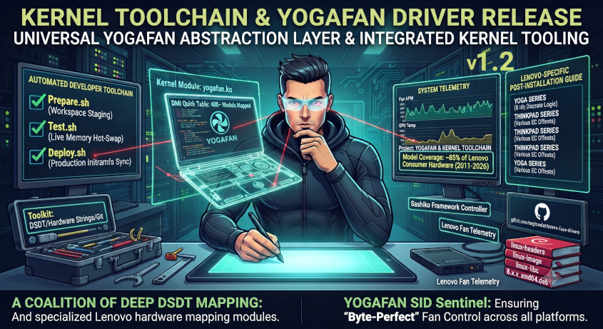

<p align="center">
  
</p>

# YOGAFAN: Lenovo Fan Home

**The Official Mainline Home of the `yogafan` Driver & Automated Upstream Kernel Deployment Toolchain for Debian**

> **Author & Maintainer:** Sergio Melas (`sergiomelas@gmail.com`) | © 2023–2026 | Released under GPL-2.0
>
> [](https://www.gnu.org/licenses/old-licenses/gpl-2.0.en.html)
> [](Lenovo_Drivers/Commits/Yogafan/Next_in_Kernel/yogafan.c)
> [](#v14--2026-11-27)
> [](Lenovo_Drivers/Prototype/PSREF/README.md)
> [](Lenovo_Drivers/Prototype/DSDT/README.md)

---

## 📖 Documentation & Repository Index

**Quick Navigation:** [Contribute DSDT](#how-to-contribute-your-hardware) • [Quick Start (`yogafan.ko`)](#quick-start-build--install-only-the-yogafan-module-out-of-tree) • [Debian Kernel Builder](#debian-package-creation-from-upstream) • [Post-Install Guide](#lenovo-specific-post-installation-guide-updated-2026) • [References](#references) • [Changelog](#changelog)

### Repository Guides
- 🚀 [Upstream Patching, Rebase & `git send-email` Guide (`UPSTREAM_PATCH_GUIDE.md`)](Lenovo_Drivers/Commits/UPSTREAM_PATCH_GUIDE.md)
- ⚙️ [Out-of-Tree Module Toolchain — `Prepare.sh` / `Test.sh` / `Deploy.sh` (`Tools/Toolchain/README.md`)](Tools/Toolchain/README.md)
- 🤖 [Official Sashiko AI Kernel Reviewer Local Guide (`SASHIKO_HOWTO.md`)](Tools/SasHiko/SASHIKO_HOWTO.md)
- 🔬 [Local Static Analysis Suite — `checkpatch`, `sparse`, `smatch` (`STATIC_ANALYSIS_SUITE.md`)](Tools/Howtos/STATIC_ANALYSIS_SUITE.md)
- 🧰 [Kernel Development & Hot-Swap Commands Cheat-Sheet (`KERNEL_COMMANDS.md`)](Tools/Howtos/KERNEL_COMMANDS.md)
- 📦 [ACPI DSDT Archive & Extraction Guide — Linux & Windows (`DSDT/README.md`)](Lenovo_Drivers/Prototype/DSDT/README.md)
- 📊 [Lenovo PSREF Master Quirk Database — 929 x86 Models (`PSREF/README.md`)](Lenovo_Drivers/Prototype/PSREF/README.md)
- 🗺️ [Lenovo Fan Controller Quick ACPI Reference (`FAN_DATABASE_REFERENCE.md`)](Lenovo_Drivers/Prototype/FAN_DATABASE_REFERENCE.md)
- 🧩 [Related Drivers Selection — `yogafan` vs `lenovo-wmi-other` vs `thinkpad_acpi`](Lenovo_Drivers/Prototype/Related%20Drivers/README.md)
- 📬 [Linux Kernel Maintainer Contacts (`KERNEL_CONTACTS.md`)](Lenovo_Drivers/Prototype/KERNEL_CONTACTS.md)

---

## Community Call to Action: Help Map the Lenovo Portfolio!

### `yogafan` Driver Compatibility: ~400 Models Covered (~85% of Lenovo Consumer Hardware)

The open-source `yogafan` hardware abstraction layer maps Embedded Controller (EC) architectures across 11 major Lenovo hardware families released between 2011 and 2026 (Yoga, IdeaPad, ThinkPad, ThinkBook, Flex, V-Series, U-Series), with the mainline driver integrated upstream starting in Linux 7.1 (`drivers/hwmon/yogafan.c`).

> [!NOTE]
> **Legion & LOQ Owners:** Modern gaming platforms with Lenovo WMI fan interfaces are natively handled via the official `lenovo-wmi-other` WMI driver. Where EC tachometer registers are exposed without WMI conflict, `yogafan` provides direct hwmon monitoring.

### How to Contribute Your Hardware

Every Lenovo line utilizes slightly different Embedded Controller (EC) offsets for thermal registers and fan telemetry. Help us safely map your device:

1. **Extract your DSDT binary table:**
   - **Linux:**
     ```bash
     sudo acpidump -b -t DSDT -o dsdt.dat   # requires acpica-tools
     ```
   - **Windows:** Run `iasl.exe -b -t DSDT` via the portable Intel ASL compiler.
2. **Collect system hardware strings:**
   - **Linux:**
     ```bash
     sudo dmidecode -s system-family
     sudo dmidecode -s system-product-name
     ```
   - **Windows (PowerShell):**
     ```powershell
     Get-CimInstance Win32_ComputerSystemProduct | Select-Object Version, Name
     ```
3. **Open a GitHub Issue:**
   - File an issue under `[DSDT Entry] <Your Laptop Model>` and attach your `dsdt.dat` along with your extracted Family and Product metadata.

**Need step-by-step help?** Check the full Linux and portable Windows walkthroughs in [`Lenovo_Drivers/Prototype/DSDT/`](Lenovo_Drivers/Prototype/DSDT/).

*Heartfelt thanks to our community pioneers for DSDT sharing: **Phani Pavan Kambhampati**, **unlockxiaom**, **PenPenIsGod**.*

---

> [!WARNING]
> **NEVER USE NON-OFFICIAL KERNELS, THIS COULD DAMAGE YOUR SYSTEM. Run instead officially distributed kernels.**
>
> We assume no responsibility for errors or omissions in the software or documentation available. In no event shall we be liable to you or any third parties for any special, punitive, incidental, indirect or consequential damages of any kind, or any damages whatsoever, including, without limitation, those resulting from loss of use, data or profits, and on any theory of liability, arising out of or in connection with the use of this software.

---

## Debian Package Creation from Upstream

These scripts install build dependencies, configure a kernel using your official Debian `.config`, apply desired kernel options, compile the kernel into `.deb` packages, and install them (if configured).

### Installation Instructions

1. Make the scripts executable and copy the desired script into the root directory of your downloaded kernel source tree.
2. Edit the top variables of the script if you want to customize options (autoinstall, custom modules, `PATCH_NAME`).
3. Run the script matching your workflow:

| Script | Description |
|---|---|
| `create-Kernel-From-Upstream.sh` | Download and prepare the latest upstream kernel |
| `auto_Compile.sh` | Compile a standard Debian kernel package (simplest build) |
| `auto_Compile_Rust.sh` | Compile a Debian kernel with Rust-for-Linux support |
| `auto_compile_rust_lenovo.sh` | Rust + AMD Zen 3 optimization (vanilla upstream-compliant build) |
| `auto_compile_rust_lenovo_drivers.sh` | Rust + AMD optimization + `yogafan` injected directly from source via `Lenovo_Drivers/yogafan.c` symlink |
| `auto_compile_rust_lenovo_patch.sh` | Rust + AMD optimization + single or multi-patch injection via `Lenovo_Drivers/Current-diff` (`hwmon-next` / `7.1+`) or `Lenovo_Drivers/Current-full` (legacy `6.x` / `7.0` with auto `Kconfig`/`Makefile` registration) |

4. Three `.deb` packages are generated in the parent directory:
   - `linux-headers-<version>.deb`
   - `linux-image-<version>.deb`
   - `linux-libc-dev_<version>.deb`
5. Install the generated packages (if not auto-installed by the script) and reboot:
   ```bash
   sudo apt-get install ./linux-headers-*.deb ./linux-image-*.deb ./linux-libc-dev_*.deb
   ```

### Removal Instructions

1. Boot into a different kernel and list installed kernel packages:
   ```bash
   dpkg --list | grep -Ei --color 'linux-image|linux-headers|linux-libc'
   ```
2. If downgrading, restore the previous `linux-libc-dev` (keep old `.deb` files):
   ```bash
   sudo apt-get install ./linux-libc-dev_<prev-ver>_amd64.deb
   ```
3. Purge unwanted kernel packages and remove leftover `/lib/modules/` directories:
   ```bash
   sudo apt-get --purge remove linux-image-<ver> linux-headers-<ver>
   modulestr=$(dpkg -S /lib/modules/* 2>&1 | grep "no path found matching pattern" | awk '{ print $NF }' | tr "\n" " ")
   sudo rm -r $modulestr
   sudo update-grub
   ```
4. To prevent/restore automatic Debian meta-package kernel updates:
   ```bash
   # Disable auto-update meta-packages:
   sudo apt-get --purge remove linux-image-amd64 linux-headers-amd64

   # Restore auto-update meta-packages:
   sudo apt-get install linux-image-amd64 linux-headers-amd64 linux-libc-dev
   ```

---

## Automated Developer Toolchain & Compilation Utilities

This repository includes an automated toolkit for building, testing, and validating out-of-tree kernel modules, upstream patch series, and Debian kernel packages.

### Core Development Tools (`Tools/` & Root)

```text
├── Lenovo_Drivers/
│   ├── Commits/UPSTREAM_PATCH_GUIDE.md        # Official upstream rebase, multi-patch & git send-email guide
│   ├── Commits/Yogafan/Next_in_Kernel/
│   │   ├── diff/                              # Multi-patch series (0000-cover-letter + 0001..N) for hwmon-next / 7.1+
│   │   ├── full/                              # Standalone full patch for legacy 6.x / 7.0 kernels
│   │   ├── yogafan.c & yogafan.rst            # Current development driver & kernel documentation
│   ├── Current-diff -> Commits/Yogafan/Next_in_Kernel/diff
│   ├── Current-full -> Commits/Yogafan/Next_in_Kernel/full
│   └── Prototype/
│       ├── DSDT/                              # Verified ACPI DSDT archive (_Added, _To add, _To explore, _Not Compatible)
│       ├── PSREF/yogafan_v3_quirks_database.ods
│       ├── FAN_DATABASE_REFERENCE.md
│       └── KERNEL_CONTACTS.md
└── Tools/
    ├── Howtos/KERNEL_COMMANDS.md              # Kernel development & module hot-swap cheat-sheet
    ├── Howtos/STATIC_ANALYSIS_SUITE.md        # Local static analysis guide (checkpatch, sparse, smatch)
    ├── SasHiko/SASHIKO_HOWTO.md               # Official Rust Sashiko AI reviewer installation & usage guide
    ├── Toolchain/                             # Out-of-tree Prepare.sh / Test.sh / Deploy.sh triplet
    └── Utilities/run_sashiko_local.sh         # Local checkpatch + sparse + smatch runner
```

### Quick Start: Build & Install Only the `yogafan` Module (Out-of-Tree)

If you want to compile and test `yogafan.ko` on your running Linux kernel without rebuilding the entire kernel:

```bash
# 1. Install kernel headers and build tools (Debian / Ubuntu)
sudo apt update && sudo apt install -y build-essential linux-headers-$(uname -r) lm-sensors

# 2. Clone the repository and enter the out-of-tree toolchain
git clone https://github.com/sergiomelas/lenovo-linux-drivers.git
cd lenovo-linux-drivers/Tools/Toolchain

# 3. Stage, compile & hot-swap test, then deploy permanently
./Prepare.sh
./Test.sh
./Deploy.sh
```

> [!NOTE]
> `Next_in_Kernel/yogafan.c` targets Linux `6.19+` / `7.x` (`devm_kzalloc_obj`). For older `6.x` kernels (e.g. `6.12` / `6.18`), use the legacy patch in [`Lenovo_Drivers/Commits/Yogafan/Next_in_Kernel/full/`](Lenovo_Drivers/Commits/Yogafan/Next_in_Kernel/full/) which uses `devm_kzalloc`.

### Local Module Build Triplet (`Tools/Toolchain/` Directory)

1. **Step 1 — Workspace Staging:**
   ```bash
   cd Tools/Toolchain && ./Prepare.sh
   ```
   Purges local build caches, stages driver source flat into `src/`, and generates an out-of-tree `Makefile` mapped to your running kernel.
2. **Step 2 — Live Memory Hot-Swapping:**
   ```bash
   ./Test.sh
   ```
   Compiles the module, performs warm `rmmod`/`insmod` hot-swap via `sudo -E`, and dumps live `sensors` and `dmesg` telemetry.
3. **Step 3 — Production Deployment & Initramfs Sync:**
   ```bash
   ./Deploy.sh
   ```
   Installs the module into `/lib/modules/$(uname -r)/kernel/drivers/hwmon/`, compresses with `xz --check=crc32`, runs `depmod`, and rebuilds initramfs.

---

## Lenovo-Specific Post-Installation Guide (Updated 2026)

### 1. Universal Fan & Sensor Support (`yogafan`)

The `yogafan` driver provides smooth, physically consistent fan RPM monitoring using a passive **RLLag (Rate-Limited Lag)** filter:

- **Slew-Rate Limiting:** Capped at 1500 RPM/s to match physical fan motor inertia.
- **Suspend Safety:** Uses `ktime_get_boottime()` for accurate delta calculation and automatic reset across system suspend/resume.
- **Precision:** 12-bit fixed-point integer math for 1-RPM step resolution with zero background polling threads.
- **Hardware Identification (DMI Quirk Table):**
  - **8-bit EC (Multiplier 100):** Yoga, IdeaPad, Slim, Flex, selected Legion/LOQ models.
  - **16-bit EC (Multiplier 1):** High-resolution dual-fan Legion, LOQ, Yoga Pro/Slim models.

#### Supported Hardware Families
- **Yoga Series:** Yoga 14cACN (`82N7`), Yoga 740-15IML (`81TD`), Yoga 730-15IWL (`81JS`), Yoga 7 16ARP8 (`83BS`), Yoga 7 16IAH7 (`82UF`), Yoga Pro 7 (`83E2`, `83KF`), Yoga Pro 9 (`83DN`, `83L0`), Yoga Slim 7 (`82A2`/`82A3`, `83HM`), Yoga 710/720/510/3/2/11s.
- **IdeaPad Series:** IdeaPad 3 (`82KU`, `82KR`), IdeaPad 5 (`81YM`, `82FG`, `81YQ`), IdeaPad 500S/510S/710S/Y580.
- **Legion & LOQ Series:** Legion Pro 7 16AFR10H (`83RU`, 3 fans), Legion Pro 7 16IAX10H (`83F5`, 3 fans), Legion 7 16ACHg6 (`82N6`), Legion Slim 5 14APH8 (`82Y5`), Legion 5/7i, LOQ 15IAX9 (`83GS`), XiaoXin Pro 13ARE.
- **Flex, ThinkBook, V-Series & U-Series:** Flex 5 (`81X1`), ThinkBook G6 (`83AK`), V-Series, U-Series.

> [!TIP]
> The driver is automatically loaded at boot via DMI matching (`MODULE_DEVICE_TABLE`). If you previously created `/etc/modules-load.d/yogafan.conf`, remove it with `sudo rm /etc/modules-load.d/yogafan.conf`.

#### Verification
```bash
sensors
# Look for 'yogafan-isa-0000'. If values are missing in KDE Plasma, run:
killall ksystemstats
```

### 2. Power Profile Integration (AMD P-State EPP)

```bash
sudo apt update && sudo apt install power-profiles-daemon
sudo systemctl enable --now power-profiles-daemon
```
Verify active driver & EPP hint:
```bash
cat /sys/devices/system/cpu/cpu0/cpufreq/scaling_driver                  # amd-pstate-epp
cat /sys/devices/system/cpu/cpu0/cpufreq/energy_performance_preference   # EPP hint
```

### 3. Advanced Fixes (Sleep & ACPI Resources)

If `sensors` shows `0 RPM` while the fan is visibly spinning due to an ACPI resource conflict:
1. Edit `/etc/default/grub` and add `acpi_enforce_resources=lax` to `GRUB_CMDLINE_LINUX_DEFAULT`.
2. Run `sudo update-grub` and reboot.

---

## References

1. **ACPI Specification (Field Objects):** https://uefi.org/specs/ACPI/6.5/05_ACPI_Software_Programming_Model.html#field-objects
2. **NBFC Projects:** https://github.com/hirschmann/nbfc/tree/master/Configs
3. **Linux Kernel Timekeeping API:** https://www.kernel.org/doc/html/latest/core-api/timekeeping.html
4. **Lenovo IdeaPad Laptop Driver:** https://github.com/torvalds/linux/blob/master/drivers/platform/x86/lenovo/ideapad-laptop.c
5. **Yogafan Community Support & DSDT Collection:** https://github.com/sergiomelas/lenovo-linux-drivers
6. **IEC 61508 / IEC 61511:** https://www.iec.ch/functional-safety
7. **ISA/IEC 62443:** https://www.isa.org/isa99
8. **Lenovo WMI Other Driver:** https://git.kernel.org/pub/scm/linux/kernel/git/torvalds/linux.git/tree/drivers/platform/x86/lenovo/wmi-other.c
9. **Lenovo Product Specifications Reference (PSREF):** https://psref.lenovo.com/

---

## Changelog

### V1.4 — 2026-11-27
- **Upstream `hwmon-next` 2-Patch Series (Anchored on `12c53b6b6`, Live-Verified on `7.4.0-rc4-yoga-amd64+`):**
  - **Patch 1/2 (`0001`):** Expanded `struct yogafan_config.paths` from `2` to `MAX_FANS` (`8`) and added 3rd fan tachometer (`FASF`, EC offset `0x04`) support for `Legion Pro 7 16AFR10H (83RU)`.
  - **Patch 2/2 (`0002`):** Added 9 user-reported Lenovo laptops (`IdeaPad 3 15ADA6 (82KR)`, `IdeaPad 5 15ARE05 (81YQ)`, `Legion 7 16ACHg6 (82N6)`, `Legion Slim 5 14APH8 (82Y5)`, `Legion Pro 7 16IAX10H (83F5, 3 fans)`, `Yoga 7 16IAH7 (82UF)`, `YOGA 730-15IWL (81JS, ERPM)`, `Yoga Slim 7 15ILL9 (83HM, 16-bit x1)`, `Yoga Pro 9 16IAH10 (83L0, H_EC 16-bit x1)`) reusing existing `yogafan_config` structs wherever identical, plus full `Documentation/hwmon/yogafan.rst` table and contributor updates.
  - **Upstream Conflict & Static Quality Gate:** Realigned insertion points for zero-fuzz, zero-conflict merge with Navon John Lukose's `83KF` fix (`hwmon` fixes) and KuwaLee's `83LC` patch on `lore.kernel.org`; verified `checkpatch.pl --strict --codespell` (`0` errors / `0` warnings / `0` checks), `sparse C=1 CF="-Wbitwise -Wnon-pointer-null" W=1` (`0` warnings), `make W=1 drivers/hwmon/yogafan.ko` (`0` warnings), and `SPHINXDIRS=hwmon make htmldocs` (`0` warnings).
  - **Live Hardware Qualification:** Compiled, installed, and booted `7.4.0-rc4-yoga-amd64+` on Lenovo Yoga 14cACN (`82N7`) with `yogafan` loaded in-tree (`yogafan-isa-0000` reporting live smoothed RPM).
- **Master PSREF Quirk Database Overhaul ([`yogafan_v3_quirks_database.ods`](Lenovo_Drivers/Prototype/PSREF/yogafan_v3_quirks_database.ods)):**
  - Cleaned database to **929 pure x86 Lenovo models** across 8 product tabs + `Head` + `Notes` (removed 50 ChromeOS `cros_ec` rows and 5 Qualcomm/ARM rows, fixed duplicate rows and year/MT typos).
  - Repaired **233+ broken PSREF links** and backfilled missing Machine Types (`DMI_PRODUCT_NAME`) from local PSREF sheets.
  - Upgraded uniform schema (`A..W`): split ACPI paths into 5 dedicated plain-ACPI columns (`M..Q`), normalized integer `Slew_time_s` (`ceil`), added `Source of Paths` (Col `T`), `DSDT Status` filter column (Col `W`: `Added` / `To add` / `To explore` / `Not Compatible`), and documented physics scaling (`Yoga 7 14ACN6` 85 mm FOPTD reference) + status definitions in `Notes`.
- **DSDT Firmware Archive Expansion ([`Lenovo_Drivers/Prototype/DSDT/`](Lenovo_Drivers/Prototype/DSDT/)):**
  - Audited and classified all **16 pending GitHub DSDT issues** (`#10`–`#27`).
  - Imported, cleaned (pruned 1,230 irrelevant SSDTs), decompiled, and forensically classified **38 consumer Lenovo DSDTs from `linuxhw/ACPI`** (`+31` verified EC tachometers in `_To add/`, `+7` in `_Not Compatible/`).
  - Archive totals: **`10`** in `_Added/`, **`42`** in `_To add/`, **`11`** in `_Not Compatible/`, **`2`** in `_To explore/`.
- **Build Automation, Legacy `6.x` Support & Repository Modernization:**
  - Split `Next_in_Kernel/` into dedicated `diff/` (`0000-cover-letter` + `0001..N` for `hwmon-next` / `7.1+`) and `full/` (standalone legacy patch using `devm_kzalloc` for Linux `6.x` / `6.18.21`), wired to folder symlinks `Lenovo_Drivers/Current-diff` and `Lenovo_Drivers/Current-full`.
  - Upgraded [`auto_compile_rust_lenovo_patch.sh`](auto_compile_rust_lenovo_patch.sh) for single-patch, symlink, and multi-patch directory support (auto-skips `0000-cover-letter.patch` and already-applied patches, and auto-registers `Kconfig`/`Makefile` on legacy kernels when missing).
  - Fixed hardcoded paths in `Tools/Toolchain/{Prepare,Test,Deploy}.sh` so out-of-tree compilation works out of the box on any machine.
  - Added `.gitignore` (protecting local kernel trees, `.tar.gz`, PDFs, and `Tools/SasHiko/Key/`), converted all 11 documentation guides from `.txt` to contextual GitHub-Flavored Markdown (`.md`) with `Media/Yogafan.png` banner, and documented official Rust `sashiko v0.9.5` in [`Tools/SasHiko/SASHIKO_HOWTO.md`](Tools/SasHiko/SASHIKO_HOWTO.md).

### V1.3 — 2026-09-11
- **Mainline Documentation & Model Integration (`tag: V1.3`):**
  - Merged upstream documentation and driver updates into the mainline Linux kernel, adding full support for `IdeaPad 3 15ALC6 Ub (82KU)` and `Yoga 740-15IML (81TD)`.
  - Polished `Documentation/hwmon/yogafan.rst` reStructuredText table alignment, column boundaries, and device naming strings (`v3`/`v4` accepted by Guenter Roeck on `linux-hwmon`).
  - Reorganized `Commits/Yogafan/` into `Current_in_Kernel/`, `Next_in_Kernel/`, and `archive/`, and updated community DSDT contributor credits.

### V1.2 — 2026-08-06
- **Enhanced Platform Identification & Quirk Validation (`tag: V1.2`):**
  - Refined DMI platform identification mechanisms and broadened fallback tolerances across Lenovo Yoga, IdeaPad, and Legion models (`Yoga Pro 9 16IMH9 (83DN)`, `Yoga 7 16ARP8 (83BS)`, `LOQ 15IAX9 (83GS)`, `Legion Pro 7 16AFR10H (83RU)`, `XiaoXinPro-13ARE 2020`).
  - Validated thermal control loops and DSDT trace mappings against real-world GitHub user hardware telemetry and lore reviews (`sashiko-bot` & Guenter Roeck).
  - Cleaned legacy rejected commit archives and consolidated DSDT submissions.

### V1.1 — 2026-06-27
- **Third Upstream Submission Wave (`Part 3 / Create_next`):**
  - Reset development pipeline onto the stable mainline V11 Part 1 baseline while preserving the full PSREF hardware database (`yogafan_v3_quirks_database.ods`).
  - Achieved clean patch application and synchronization across both `hwmon-next` and Linux `7.1.1`.
  - Introduced the automated local out-of-tree driver triplet (`Tools/Toolchain/{Prepare,Test,Deploy}.sh`) and structured the DSDT hardware archive (`Lenovo_Drivers/Prototype/DSDT/`).

### V1.0 — 2026-04-28
- **Yogafan V3 (Part 2) Research & HAL Expansion:**
  - Researched `N_max`/`R_max` discrete EC logic (Yoga 710/510, IdeaPad 500S/U31), `FAN0`/`FA2S` path mapping (ThinkBook G6, IdeaPad 5, Flex 5, LOQ), 32-bit `div64_s64` safety, and WMI coexistence GUID detection for modern Legion/LOQ platforms.

### V0.9 — 2026-04-01
- **Refactored `yogafan` v12:**
  - Added Register `0x06` architecture and `FAN0` ACPI path mapping; excluded non-RPM reporting configs to keep strict `hwmon` compliance.

### V0.8 — 2026-04-01
- **MAJOR MILESTONE — Upstream Mainline Acceptance (`linux-next` / Linux `7.1`):**
  - `yogafan` V11 accepted upstream into Guenter Roeck's `hwmon-next` tree (`100 ms` `MIN_SAMPLING`, fixed-point RLLag filter, `ktime_get_boottime()` suspend safety, DMI-driven `platform_device` probing, 0-day robot clean).

### V0.7 — 2026-03-25
- **RLLag Filter, S3 Sleep & KDE Plasma 6 Integration:**
  - Implemented 100 ms fixed-point RLLag inertia filter, S3 sleep DSTS handling, multi-fan `FA2S`/`FAN0` support, and Debian `.deb` build script naming fixes.

### V0.6 — 2026-03-14
- Created initial standalone Linux kernel driver module for `yogafan`.

### V0.5 — 2026-02-08
- Added kernel name personalization, Rust DRM Panic QR BSOD, AMD Zen 3 / Lenovo Yoga 14cACN optimizations, automatic Debian `.config` detection, and stripped debug `.deb` packaging.

### V0.4 — 2025-05-01
- Build script bugfixes.

### V0.3 — 2025-04-27
- Integrated Rust-for-Linux abstraction layers and LLVM/Clang ThinLTO toolchain support.

### V0.2 — 2024-07-21
- First public release with expanded automated Debian kernel build features.

### V0.1 — 2021-12-28
- Initial personal kernel build script release.
